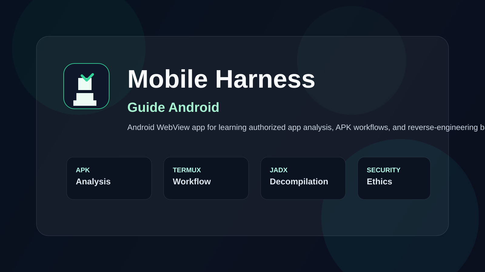

# Mobile Harness Guide Android

<p align="center">
  <a href="https://github.com/sonu-999/mobile-harness-guide-android/stargazers"></a>
  <a href="https://github.com/sonu-999/mobile-harness-guide-android/forks"></a>
  <a href="https://github.com/sonu-999/mobile-harness-guide-android/issues"></a>
  <a href="LICENSE"></a>
  <a href="#quick-start"></a>
</p>

<p align="center">
  
</p>

A polished Android WebView learning app and guide for beginners exploring authorized Android app analysis, reverse-engineering workflows, APK decompilation, and safe mobile security practice.

This project packages the Mobile Harness learning journey into a clean mobile-first experience, making complex Android workflows easier to understand, easier to follow, and easier to share.

## Why this project stands out

- beginner-friendly Android reverse engineering education
- step-by-step workflow from setup to APK analysis
- guided lessons for Termux, Mobile Harness, JADX, decompilation, and rebuild flows
- focused on ethical, authorized testing of apps you own or are allowed to assess
- built as a realistic Android app shell with a polished dark UI

## SEO and discovery keywords

This repository is positioned around keywords such as:

- Android reverse engineering guide
- Mobile Harness tutorial
- APK analysis Android
- Android security research
- Smali patching guide
- Termux Android reverse engineering
- APK decompilation tutorial
- Android app analysis workflow
- authorized mobile app testing
- Android WebView learning project

## Features

- dark glassmorphism-inspired UI
- stage-based walkthrough for key Android analysis steps
- copy-ready shell commands for setup and testing workflows
- clean local content host via Android WebView
- beginner-oriented explanation of reverse engineering concepts
- structured educational flow for safer mobile research practice

## Quick start

### 1) Clone

```bash
git clone https://github.com/sonu-999/mobile-harness-guide-android.git
cd mobile-harness-guide-android
```

### 2) Build the Android app

```bash
./gradlew assembleDebug
```

### 3) Open the generated APK

The debug APK is usually generated here:

```text
app/build/outputs/apk/debug/app-debug.apk
```

## Project structure

```text
.
├── MH.html                  # Main interactive guide content
├── README.md                # Project overview and landing page
├── LICENSE                  # MIT license
├── index.html               # Lightweight landing-page entry for SEO/front-end polish
├── assets/
│   └── gh-banner.svg        # GitHub banner / social preview asset
├── docs/
│   ├── CONTRIBUTING.md      # Contribution guidelines
│   ├── INSTALL.md          # Setup instructions
│   └── SECURITY.md          # Responsible use and disclosure guidance
├── app/
│   └── src/
│       └── main/
│           ├── res/
│           └── ...
├── 1794234703701.png        # Repository screenshot preview
├── SONU REA MOBILE HARNESS_1.apk
├── .gitignore
└── .github/
```

## Learning flow included

The guide walks through:

1. preparing Termux and Android dependencies
2. extracting a target APK
3. decompiling and inspecting app structure
4. reviewing Smali and resources
5. patching logic safely and responsibly
6. rebuilding and signing an APK
7. installing for authorized testing in a controlled environment

## Responsible use

This project is intended for:

- education
- authorized testing of apps you own or are given permission to assess
- Android development and reverse-engineering study
- safe exploration of Android app structures in controlled settings

It must not be used for unauthorized access, malware creation, credential theft, or unlawful activity.

## Contributing

Contributions are welcome. Please see the contribution guide before submitting a PR.

- [Contributing guide](docs/CONTRIBUTING.md)
- [Install guide](docs/INSTALL.md)
- [Security policy](docs/SECURITY.md)

## Roadmap

Planned improvements include:

- clearer onboarding and install instructions
- more visual polish and UI refinements
- improved accessibility and mobile compatibility
- better repository branding and release packaging
- stronger beginner-focused educational sections

## License

This project is licensed under the [MIT License](LICENSE).

## Maintainer

- [sonu-999](https://github.com/sonu-999)

## Star this repository

If this project helps you learn Android reverse engineering, APK analysis, or mobile security research in a safer and more structured way, a star helps support the project and visibility.

---

Built to make Android reverse-engineering learning more approachable, more readable, and easier to discover on GitHub.

"A cleaner, more discoverable guide for authorized Android app analysis and reverse-engineering learning."


